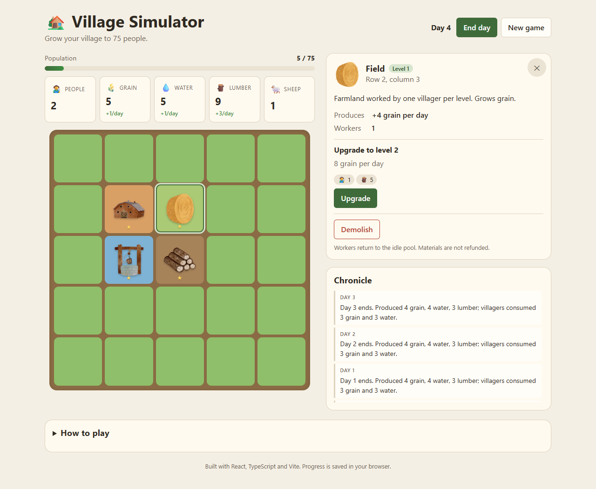
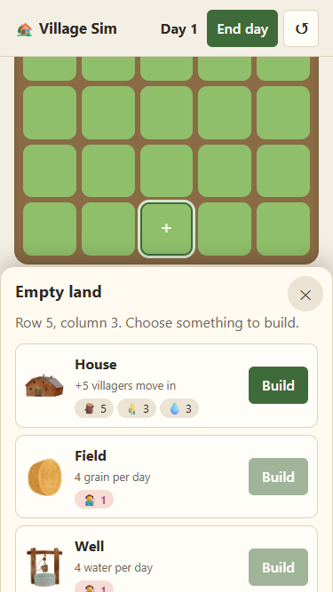

# 🏡 Village Simulator

A turn-based village-building game built with **React**, **TypeScript** and **Vite**. Place houses, fields, wells, lumber mills and pastures on a 5×5 map, keep your villagers fed and watered, and grow the settlement to 75 people in as few days as possible.

**[▶ Play it live](https://jgreener6.github.io/Village-Simulator-Game/)**

<p>
  
  
</p>

## Features

- **Resource economy.** Five resources (villagers, grain, water, lumber, sheep) with per-level costs, production and housing.
- **Day cycle.** Buildings produce at the end of each day and villagers consume food and water. Shortages drive people away.
- **Upgrades and demolition.** Every building has three levels. Workers are reassigned when a building is torn down.
- **Live forecasts.** Each resource shows its expected net change per day. Costs you can't afford are highlighted.
- **Autosave.** Progress persists to `localStorage` and is validated on load.
- **Accessible.** The map is a keyboard-navigable grid (arrow keys), every control has a descriptive label, and the event log is announced to screen readers.
- **Mobile-first details.** On phones the tile menu opens as a bottom sheet, the header with **End day** stays pinned, and the selected tile scrolls into view above the sheet.
- **Responsive, light and dark themes.** Built with CSS custom properties. No UI library.

## Tech stack

| Area      | Tools                                                     |
| --------- | --------------------------------------------------------- |
| UI        | React 19 (function components, `useReducer`), TypeScript  |
| Build     | Vite                                                      |
| Testing   | Vitest, React Testing Library, user-event                 |
| Quality   | ESLint (typescript-eslint, react-hooks), strict TS        |
| CI/CD     | GitHub Actions → GitHub Pages                             |

## Architecture

The game rules live in plain TypeScript, separate from React:

```
src/
├── assets/images/      # Building art from the v1 team project
├── game/
│   ├── config.ts       # Balance data: costs, production, goals
│   ├── logic.ts        # Pure reducer + derived-state queries
│   ├── logic.test.ts   # Unit tests for the rules
│   ├── types.ts        # GameState, GameAction, Resources…
│   └── useGame.ts      # useReducer + localStorage persistence
├── components/
│   ├── Board/          # 5×5 map with roving-focus keyboard nav
│   ├── ResourcesView/  # Stockpiles, daily forecast, goal progress
│   ├── TilePanel/      # Build / upgrade / demolish controls
│   ├── EventLog/       # The village chronicle
│   └── HowToPlay/
└── App.tsx
```

Every state change goes through `gameReducer(state, action)`. That makes the rules deterministic and easy to unit test, and the components only render state and dispatch actions. Values like population, daily production and costs are derived from state rather than stored, so they can't fall out of sync.

## Getting started

Requires Node.js 20.19+.

```bash
npm install
npm run dev        # start the dev server
npm test           # run tests in watch mode
npm run lint
npm run build      # type-check and build to dist/
```

## Deployment

`.github/workflows/ci.yml` lints, tests and builds every push and pull request. Pushes to `main` are deployed to GitHub Pages. To enable it, set **Settings → Pages → Source** to **GitHub Actions**.

## How to play

1. Build a **house** so settlers have somewhere to live.
2. Assign villagers to **fields** (grain), **wells** (water), **lumber mills** (lumber) and **pastures** (sheep). Each building level needs one worker.
3. Press **End day** to collect production. Every two villagers eat one grain and drink one water per day.
4. Upgrade buildings to level 3 for more output and more housing.
5. Reach **75 villagers** to win.

## Project history

**v1 (May 2023): team project.** Built during the [Grand Circus](https://www.grandcircus.co/) bootcamp by [Kate Grutter](https://github.com/KateGrutter), [Justin Green](https://github.com/jgreener6) and [Desiree Cushing](https://github.com/descush) with Create React App. Justin built the add-improvement dialog and tile rendering, Kate designed the component structure and resource alerts, and Desiree built upgrades and downgrades. That version is preserved in this repo's git history.

**v2 (2026): solo rewrite by Justin Green.** The game was rebuilt from scratch with a tested reducer-based engine, a day/upkeep cycle and win condition, keyboard and screen-reader support, a mobile layout, and CI/CD. The watercolor building art comes from the original team version.
